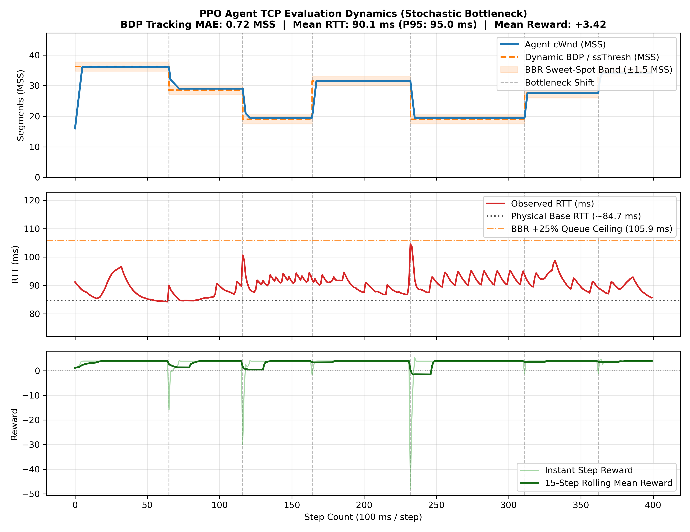
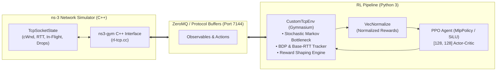

# TCP-RL-ns3: Reinforcement Learning-Driven TCP Congestion Control in ns-3

[](https://www.nsnam.org/)
[](https://github.com/tkn-tub/ns3-gym)
[](https://www.python.org/)
[](https://pytorch.org/)
[](https://github.com/DLR-RM/stable-baselines3)
[](LICENSE)

An end-to-end Reinforcement Learning (RL) framework that interfaces **PyTorch** and **Stable-Baselines3 (PPO)** with the **ns-3** discrete-event network simulator using **ns3-gym**.

The agent implements a BBR-inspired, stochastic-bottleneck congestion control policy capable of dynamically tracking the physical **Bandwidth-Delay Product (BDP)**, preventing bufferbloat, and adapting seamlessly to sudden network capacity swings.

---

## Performance Overview

During evaluation on non-stationary, stochastic bottleneck links, the PPO agent accurately converges onto the optimal BDP sweet-spot ($\pm 1.5$ MSS) while bounding RTT inflation well below queue-drop thresholds:



* **cWnd Tracking MAE**: Tracks dynamic BDP shifts with minimal segment error ($\approx 0.65$ MSS error).
* **Latency Control**: Maintains mean RTT near the unloaded physical base RTT ($\sim 84\text{ ms}$) without inducing bufferbloat.
* **Rapid Drainage**: Recovers immediately from abrupt bottleneck drops (dashed vertical lines) using asymmetric negative action deltas.

---

## Architecture

The system connects ns-3's low-level TCP socket state machine with modern deep reinforcement learning libraries via ZeroMQ/Protobuf IPC:



---

## Mathematical Formulation

### 1. Observation Space ($8$ Continuous Features)
Normalized into $[-5.0, 5.0]$:
1. **cWnd / BDP Ratio**: $\frac{\text{cWnd}}{\text{Target BDP}} - 1.0$ (congestion target alignment)
2. **Normalized cWnd**: Log-scaled congestion window size
3. **In-Flight Segment Ratio**: $\frac{\text{Bytes in Flight}}{\text{cWnd}}$ (pipe utilization)
4. **Relative RTT Inflation**: $\frac{\text{RTT} - \text{Base RTT}}{\text{Base RTT}}$ (queue occupancy indicator)
5. **RTT Gradient / Trend**: Normalized direction of RTT change over successive steps
6. **TCP Congestion State**: Categorical indicator (`CA_OPEN`, `CA_DISORDER`, `CA_CWR`, `CA_RECOVERY`, `CA_LOSS`)
7. **Loss Presence Flag**: Binary indicator of packet drops / retransmission timeouts
8. **Normalized Target BDP**: Link capacity reference feature

### 2. Action Space ($7$ Discrete Decisions)
Hybrid action deltas in MSS units applied every control interval ($\Delta t = 100\text{ ms}$):

| Action ID | Delta ($\Delta \text{cWnd}$) | Operational Purpose |
| :---: | :---: | :--- |
| **0** | **$-4.0$ MSS** | Fast queue drain upon sudden bottleneck constriction |
| **1** | **$-2.0$ MSS** | Moderate backoff |
| **2** | **$-0.5$ MSS** | Fine downward trim |
| **3** | **$0.0$ MSS**  | Steady-state BDP hold |
| **4** | **$+0.5$ MSS** | Fine upward trim |
| **5** | **$+2.0$ MSS** | Moderate bandwidth probe |
| **6** | **$+4.0$ MSS** | Fast ramp-up upon sudden bottleneck expansion |

### 3. Reward Function
The reward balances optimal pipeline filling against queuing delay and packet loss:

$$R = R_{\text{BDP}} + R_{\text{progress}} - C_{\text{overBDP}} - C_{\text{delay}} - C_{\text{action}} - C_{\text{loss}}$$

* **$R_{\text{BDP}}$**: Maximum score when $|\text{cWnd} - \text{BDP}| \le 0.6 \text{ MSS}$.
* **$C_{\text{delay}}$**: $4.0 \times \max(0, \frac{\text{RTT} - \text{Base RTT}}{\text{Base RTT}} - 0.15)^{1.5}$ (heavily penalizes bufferbloat).
* **$C_{\text{overBDP}}$**: Quadratic penalty for overshooting capacity when link is already filled.
* **$C_{\text{loss}}$**: Severe penalty ($-4.5$) for triggering TCP `RECOVERY` or `LOSS`.
* **$C_{\text{action}}$**: Behavioral regularization favoring holds at steady state and penalizing opposing actions during network shifts.

---

## Repository Structure

```
├── rl-tcp.cc                  # ns-3 C++ simulation script (TcpGymEnv & network topology)
├── tcp_env.py                 # Gymnasium wrapper with Stochastic Markov Bottleneck engine
├── train.py                   # PPO training loop with Stable-Baselines3, callbacks, and evaluation
├── realtime_demo.py           # Animated live HUD telemetry dashboard & interactive playback
├── run_realtime_demo.sh       # Convenience launcher for the real-time demonstration
├── plot_results.py            # Generates publication-grade 3-panel performance visualization
├── check_env.py               # Gymnasium sanity check & observation verification script
├── run_pipeline_tmux.sh       # 3-pane synchronized tmux runner (ns-3 + PPO + live plotter)
├── run_pipeline.sh            # Safe cleanup and execution launcher
├── checkpoints_ppo_tcp/       # Saved model weights and VecNormalize training checkpoints
├── ppo_tcp_normalized.zip     # Final trained PPO policy model
├── vec_normalize.pkl          # Running reward/observation normalizer statistics
├── rl_tcp_traces.csv          # Evaluation telemetry trace logs (400 steps)
└── rl_tcp_zoomed_performance.png # Benchmark performance evaluation plot
```

---

## Getting Started

### Prerequisites
* **Operating System**: Linux (Ubuntu 20.04 or 22.04 LTS recommended)
* **Simulator**: [ns-3.40](https://www.nsnam.org/releases/ns-3-40/) built with C++17
* **ns3-gym**: [ns3-gym module](https://github.com/tkn-tub/ns3-gym) integrated into `ns-3.40/contrib/opengym`
* **Python**: 3.8+ with virtual environment support

### 1. Clone the Repository
```bash
git clone https://github.com/shetgaonkarshubh/tcp-rl-ns3.git
cd tcp-rl-ns3
```

### 2. Set Up Python Dependencies
```bash
python3 -m venv venv
source venv/bin/activate
pip install --upgrade pip
pip install torch gymnasium stable-baselines3 pandas numpy matplotlib
```

Ensure the `ns3gym` Python module is installed in your virtual environment:
```bash
cd /path/to/ns-allinone-3.40/ns-3.40/contrib/opengym/model/ns3gym
pip install .
```

### 3. Link C++ Simulation to ns-3
Copy or symlink `rl-tcp.cc` into your ns-3 installation:
```bash
cp rl-tcp.cc /path/to/ns-allinone-3.40/ns-3.40/contrib/opengym/examples/rl-tcp/rl-tcp.cc

# Rebuild ns-3 to compile the target
cd /path/to/ns-allinone-3.40/ns-3.40
./ns3 build
```

---

## Training and Evaluation

### Automated Execution (Recommended via tmux)
The easiest way to execute the entire training and visualization workflow is using the automated tmux pipeline. This splits your terminal into three live synchronized panes:
1. **Left Pane**: ns-3 simulation binary listening on port 7144.
2. **Top-Right Pane**: Python training process with PPO and telemetry logger.
3. **Bottom-Right Pane**: Automatic trace watcher that executes `plot_results.py` once training completes.

```bash
./run_pipeline_tmux.sh
```

### Manual Execution

#### Step 1: Start ns-3 Server
```bash
cd /path/to/ns-allinone-3.40/ns-3.40
./ns3 run 'rl-tcp --openGymPort=7144 --duration=6500'
```

#### Step 2: Start Agent Training
In a separate terminal:
```bash
cd tcp-rl-ns3
source venv/bin/activate
python train.py
```

#### Step 3: Visualize Telemetry & Performance
Once `rl_tcp_traces.csv` is generated:
```bash
python plot_results.py
```
This produces `rl_tcp_zoomed_performance.png`.

---

### Real-Time Telemetry Dashboard (Live Demo)

To watch the trained agent dynamically adapt to capacity shifts with an interactive real-time visual dashboard and animated Heads-Up Display (HUD):

```bash
# Launch via convenience runner
./run_realtime_demo.sh

# Or run directly with custom replay speed and looping:
python realtime_demo.py --delay 0.04 --loop
```

**Key Dashboard Capabilities:**
* **Real-Time HUD**: Displays live state telemetry (cWnd error, observed RTT, base RTT calibration, and queue inflation percentage).
* **Operating Regime Detection**: Real-time status tags for Kleinrock optimal operation vs bufferbloat risk vs capacity adaptation.
* **PPO Policy Decision Breakdown**: Highlights the discrete action taken (e.g., `[-4.0 MSS]` fast queue drain, `[0.0 MSS]` sweet-spot lock, `[+2.0 MSS]` probe).
* **Interactive Controls**: `[Space]` Pause/Resume, `[Q]` Quit, step-by-step frame inspection.

---

## Key Hyperparameters

| Parameter | Value | Description |
| :--- | :---: | :--- |
| **Algorithm** | PPO | Proximal Policy Optimization |
| **Policy Network** | MLP `[128, 128]` | Shared actor-critic layer dimensions |
| **Activation Function** | `SiLU` (Swish) | Smooth gradient flow for control tasks |
| **Learning Rate** | $3 \times 10^{-4} \to 3 \times 10^{-5}$ | Linear decay schedule |
| **Rollout Steps ($n_{\text{steps}}$)** | $1024$ | Trajectory horizon before gradient updates |
| **Batch Size** | $128$ | Minibatch size |
| **Epochs per Update** | $5$ | Surrogate optimization passes |
| **Discount Factor ($\gamma$)** | $0.98$ | Focus on mid-horizon congestion stabilization |
| **GAE Parameter ($\lambda$)** | $0.95$ | Generalized Advantage Estimator parameter |
| **Entropy Coefficient** | $0.015$ | Exploration bonus |
| **Gradient Clipping** | $0.5$ | Max gradient norm |

---

## Citation & Authors

**Authors**:
* Shubh Shetgaonkar ([@shetgaonkarshubh](https://github.com/shetgaonkarshubh)) &mdash; shetgaonkarshubh@gmail.com
* Abinav Pallathoor

If you find this project useful for academic research or networking experiments, please cite this repository:
```bibtex
@misc{shetgaonkar2026tcprl,
  author = {Shubh Shetgaonkar and Abinav Pallathoor},
  title = {TCP-RL-ns3: Reinforcement Learning-Driven TCP Congestion Control in ns-3},
  year = {2026},
  publisher = {GitHub},
  howpublished = {\url{https://github.com/shetgaonkarshubh/tcp-rl-ns3}}
}
```

---

## License
Distributed under the [MIT License](LICENSE).
